# Evidencia: motor de fondos animados de Lever

Validación funcional del motor de escenas (`src/components/apariencia/`) en `/muestrario` → «Escenas» → «Ver escenas»,
corrida sobre el head rebasado contra `origin/main` (con #44).
Dev en el puerto 4794 y el diseño original (`fPlat.html`) servido en el 4795. Playwright 1.64.1 headless, sin el
navegador compartido del MCP. Cada botón del panel se clicó de verdad (`locator.click`); en el diseño original se usaron
los controles de su panel de Apariencia (`data-act="scene" | "theme" | "apMot" | "apDyn"`).

- `registro-gpu.txt`: 75 verificaciones en verde con GPU real (ANGLE Metal, Apple M5 Pro).
- `registro-swiftshader.txt`: equipo lento simulado con SwiftShader (render por software, sin GPU).
- `scripts/`: los scripts que generaron todo (`validar.mjs`, `comparar-shaders.mjs`, `costo-gpu.mjs`, `generar-fs.py`).

## Capturas de la app (escena viva, con el panel de prueba)

| Escena | Tema | 1440 × 900 | 390 × 844 (DPR 3) |
| --- | --- | --- | --- |
| Bruma | Oscuro | 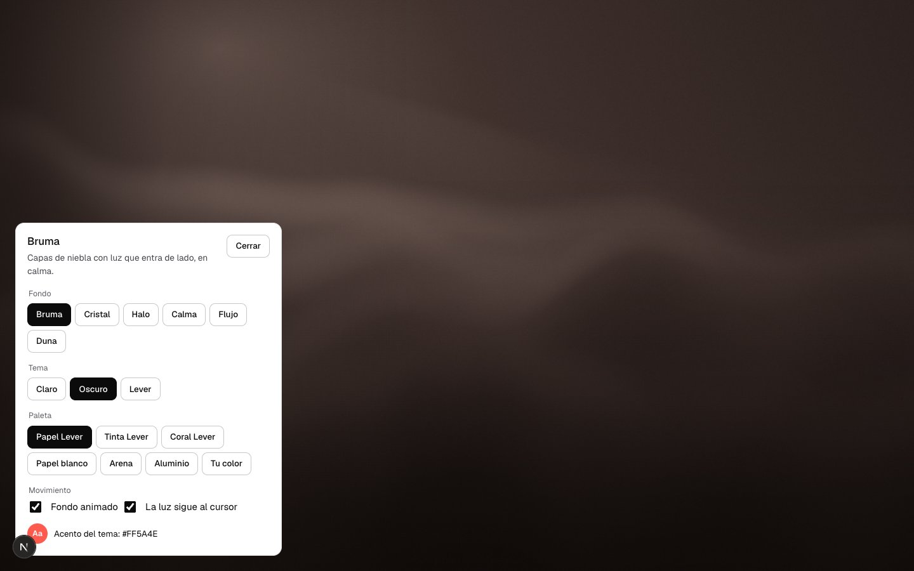 | 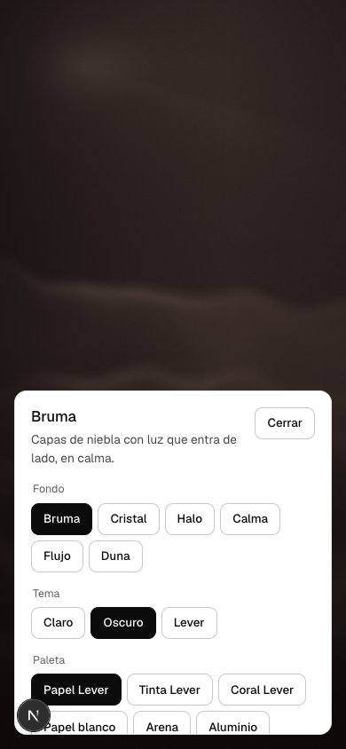 |
| Cristal | Oscuro | 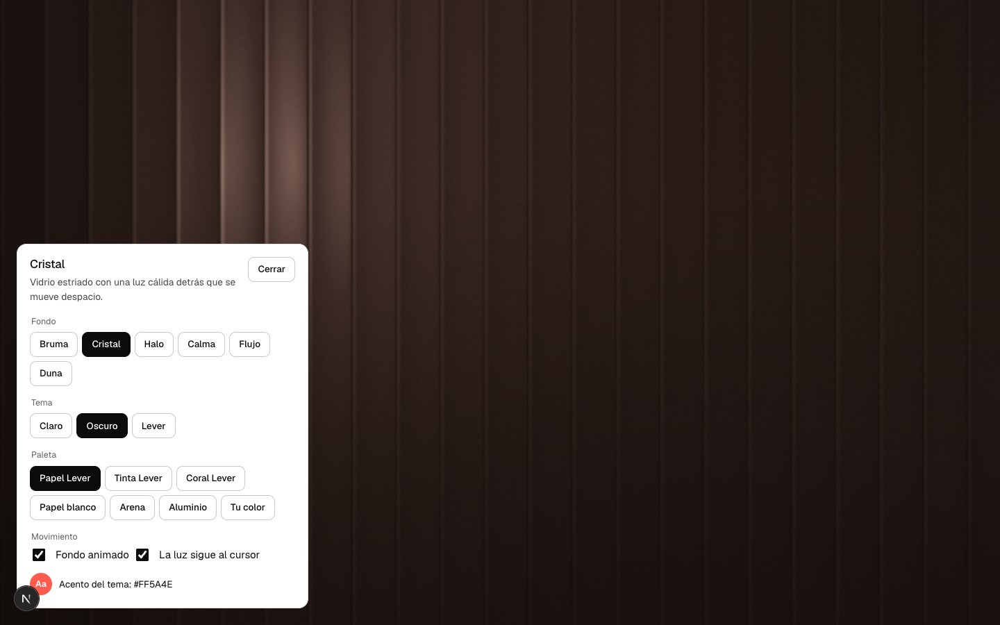 | 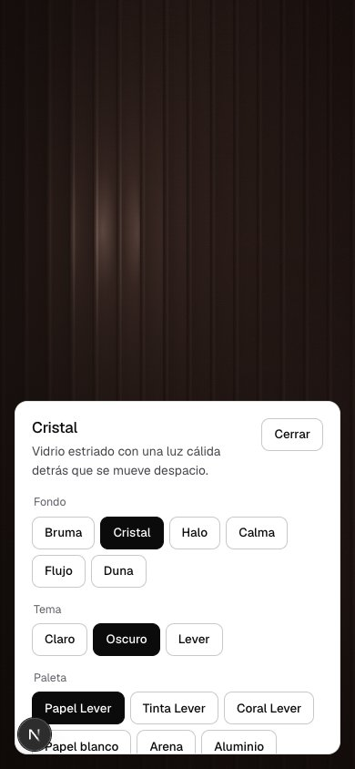 |
| Halo | Oscuro | 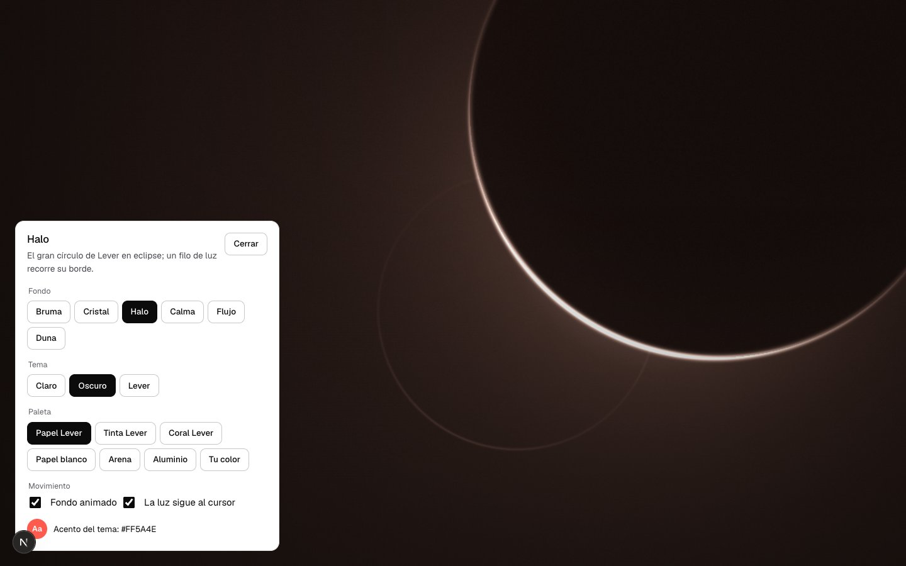 | 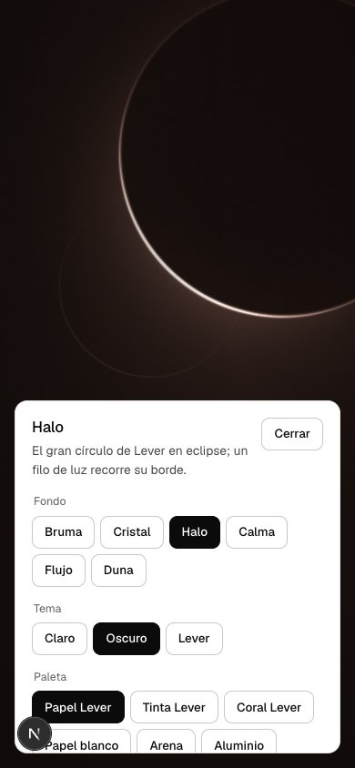 |
| Calma | Oscuro | 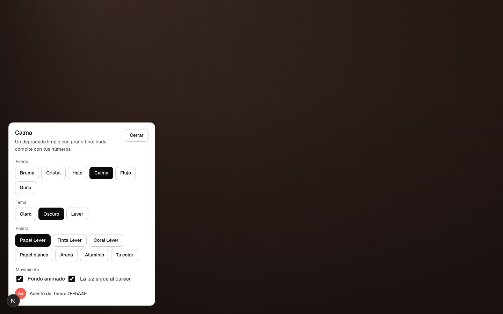 | 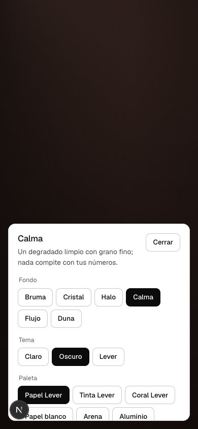 |
| Flujo | Oscuro | 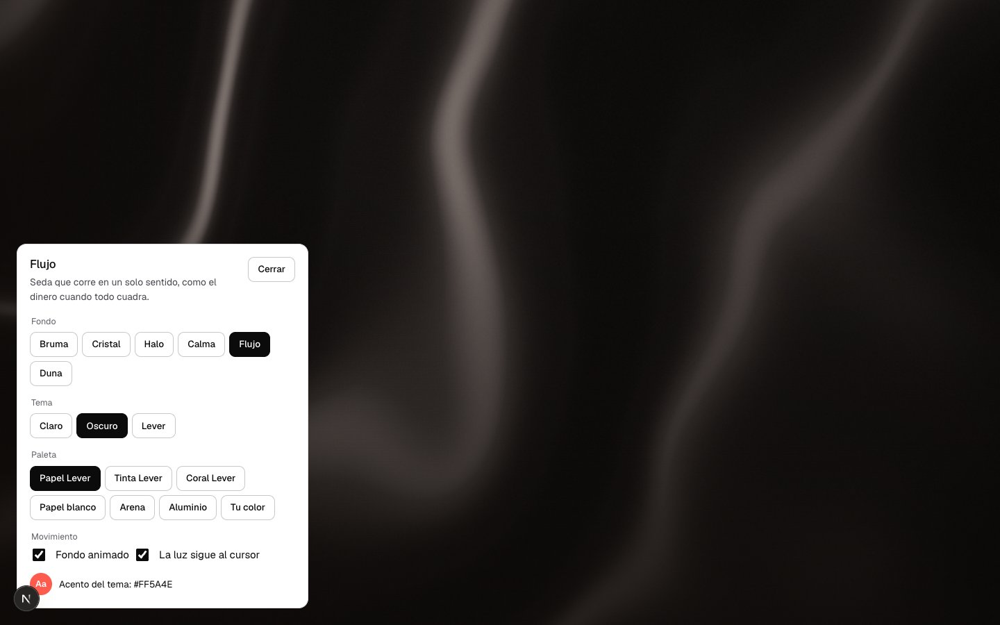 | 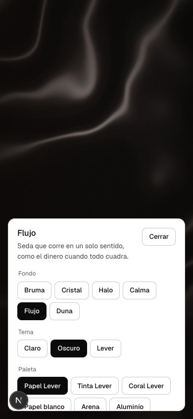 |
| Duna | Oscuro | 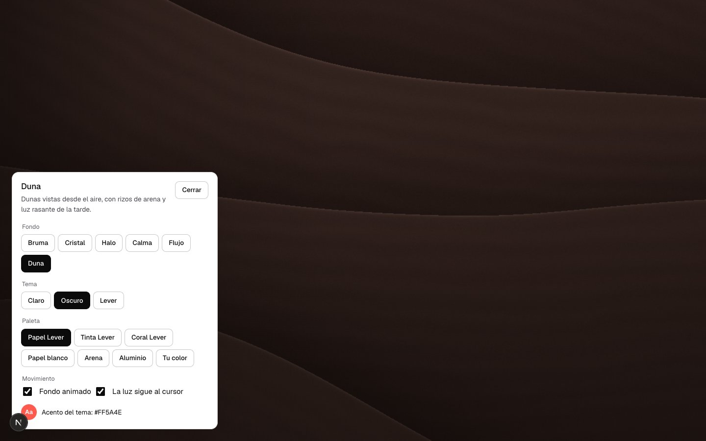 | 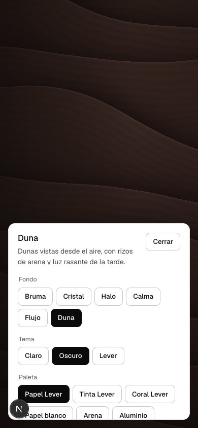 |
| Bruma | Claro | 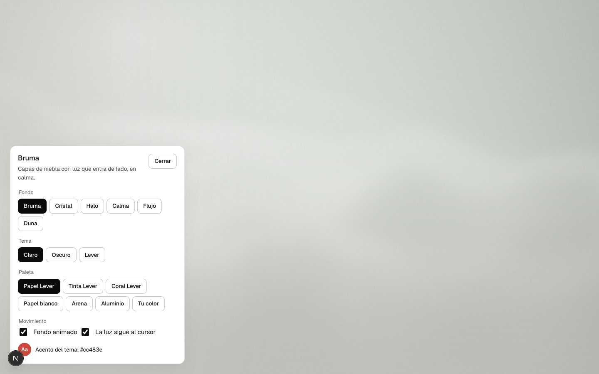 | 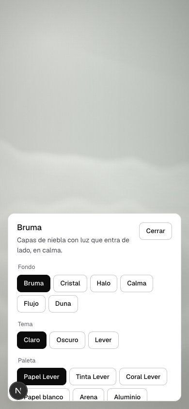 |
| Bruma | Lever | 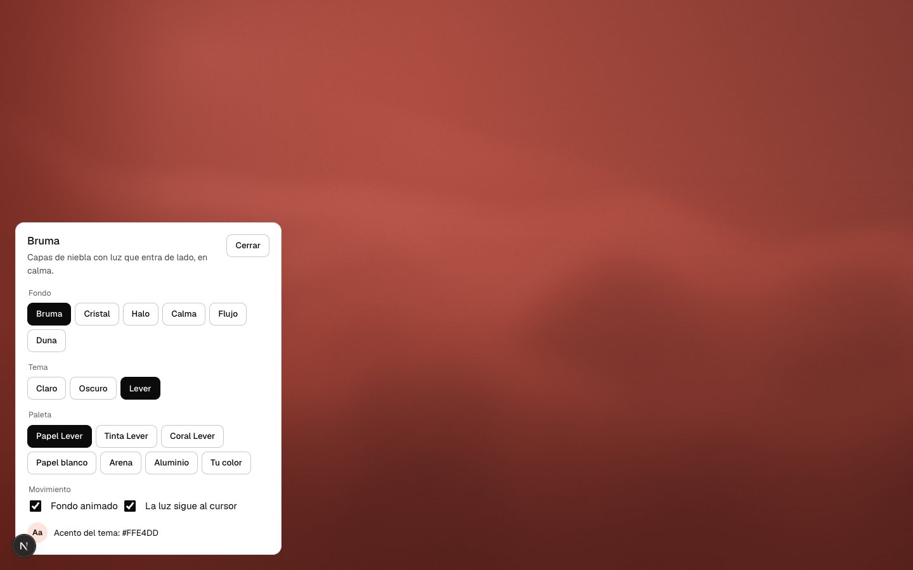 | 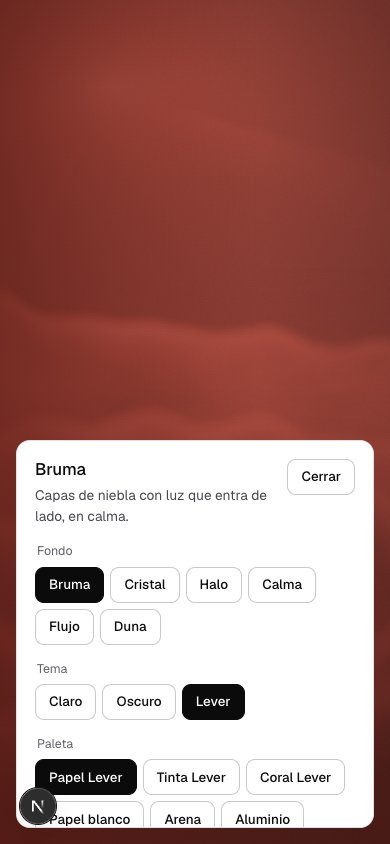 |

Extras: `bruma-tu-color-1440.jpg` (Tu color #3CC48F), `reducir-movimiento-1440.jpg`, `equipo-lento-1440.jpg`.

En 390 × 844 el lienzo mide 663 × 1435: escala 0.85 con DPR tope 2 aunque el teléfono sea DPR 3.

## Diseño original contra la app (escena quieta, sin interfaz encima)

Ambos con «Fondo animado» y «La luz sigue al cursor» apagados: instante fijo `t = 4` y luz en reposo `(-0.3, -0.8)`,
así la comparación es píxel a píxel. La diferencia se midió a 1440 × 900; las imágenes se guardaron a 720 px de ancho.

| Caso | Diseño | App | Diferencia media | Píxeles con > 8 niveles | Máx. |
| --- | --- | --- | --- | --- | --- |
| Bruma |  | 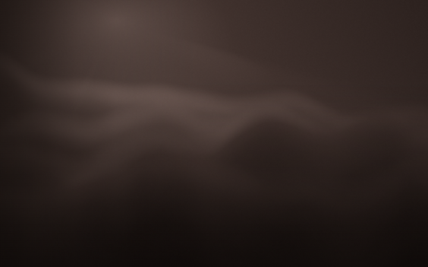 | 0.004 / 255 | 0 % | 1 |
| Cristal |  | 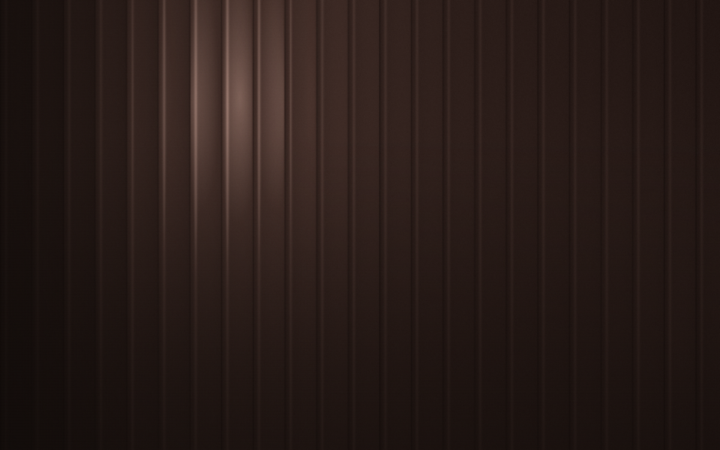 | 0 / 255 | 0 % | 1 |
| Halo | 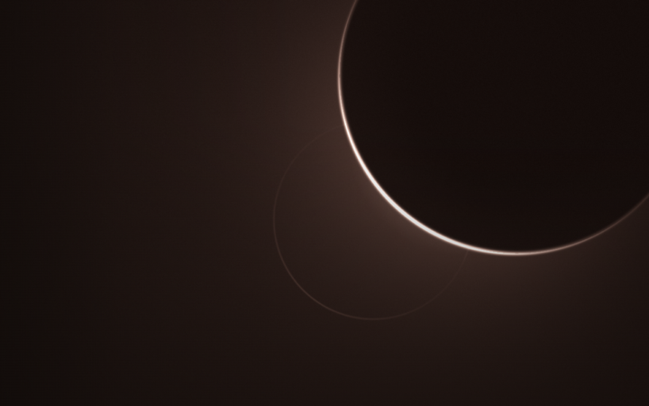 |  | 0 / 255 | 0 % | 0 |
| Calma |  |  | 0 / 255 | 0 % | 0 |
| Flujo | 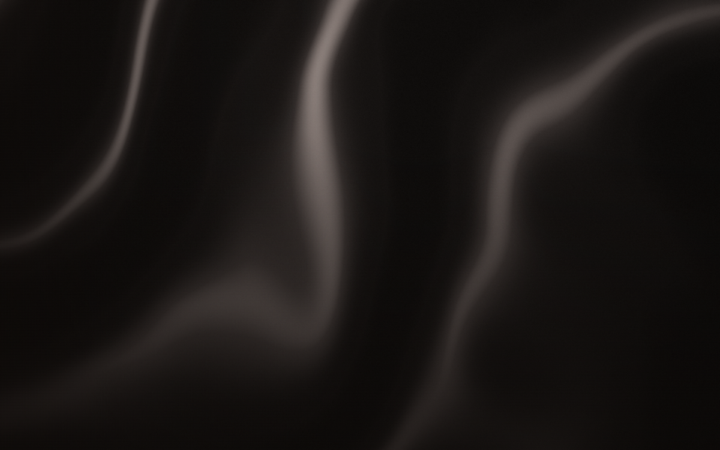 |  | 0 / 255 | 0 % | 1 |
| Duna | 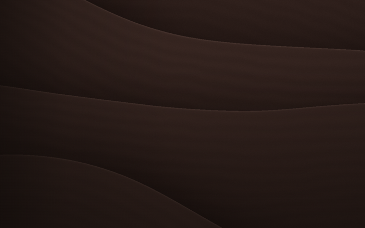 |  | 0 / 255 | 0 % | 0 |
| Bruma · Claro |  |  | 0 / 255 | 0 % | 0 |
| Bruma · Lever |  |  | 0 / 255 | 0 % | 1 |

`bruma-diseno-con-interfaz.jpg` muestra el diseño con su plataforma encima, como referencia de uso.

Única diferencia intencional: en pantallas de menos de 565 px el velo del diseño corta su degradado en seco a 260 px y
deja una línea vertical (`velo-390-diseno-original.jpg`). `escena.css` usa `min(260px, 46%)` / `max(46%, 260px)`; desde
565 px de ancho el velo es idéntico (la tabla de arriba lo confirma a 1440).

## Shader recortado contra el completo

El fragment shader del diseño trae 40 escenas (949 líneas). `motor.ts` conserva solo bruma, cristal, halo, calma, flujo
y duna, las funciones que usan (`hash`, `vn`, `fbm`, `fbm3`, `g2`, `spow`, `rot`, `ramp`, `metalize`, `hair`) y el
`main` completo (viñeta, velo de lectura, desvanecido y grano): 171 líneas. Ambos se compilaron en el mismo contexto y
se compararon con `readPixels` en 48 casos (6 escenas × 4 tonos × 2 instantes y luces) a 640 × 400:

| Renderer | Bytes distintos | Diferencia máxima | Compilar + enlazar (completo → recortado) |
| --- | --- | --- | --- |
| SwiftShader | 0 de 49 152 000 | 0 | 18.6 ms → 3.4 ms |
| Metal (M5 Pro) | 45 de 49 152 000 | 1 nivel de 255 | 243 ms → 66 ms en frío; 36 ms → 7 ms con caché |

En Metal la diferencia de 1 nivel en 45 bytes viene del optimizador del compilador; no es visible.

## Costo por cuadro

El fondo dibuja un cuadro de cada tres (20 por segundo a 60 Hz).

**Tiempo de dibujo medido en el componente con `performance.now()`** (lo que bloquea el hilo principal, promedio de 3 s
por escena, Metal):

| Escena | DPR 1 (1224 × 765) | DPR 2 (2448 × 1530) | Cuadros de la página |
| --- | --- | --- | --- |
| Bruma | 0.14 ms | 0.15 ms | 60/s |
| Cristal | 0.13 ms | 0.13 ms | 60/s |
| Halo | 0.15 ms | 0.12 ms | 60/s |
| Calma | 0.14 ms | 0.11 ms | 60/s |
| Flujo | 0.12 ms | 0.12 ms | 60/s |
| Duna | 0.16 ms | 0.16 ms | 60/s |

**Costo de GPU** (dibujo + `readPixels` de 1 px para esperar a la GPU, promedio de 20, `costo-gpu-metal.txt`):

| Lienzo | Bruma | Cristal | Halo | Calma | Flujo | Duna |
| --- | --- | --- | --- | --- | --- | --- |
| 1224 × 765 | 1.44 ms | 0.41 ms | 0.32 ms | 0.34 ms | 0.40 ms | 1.00 ms |
| 2448 × 1530 | 4.28 ms | 0.95 ms | 0.50 ms | 0.64 ms | 0.95 ms | 3.90 ms |
| 663 × 1435 (teléfono) | 1.71 ms | 0.53 ms | 0.42 ms | 0.45 ms | 0.51 ms | 1.44 ms |

Sin GPU (SwiftShader, `costo-gpu-swiftshader.txt`) cada cuadro cuesta de 26 a 51 ms a DPR 1. Por eso existe la
detección de equipo lento: tras 20 cuadros de calentamiento mide ventanas de 60; si el dibujo bloquea más de 12 ms en
promedio o la página baja de 40 cuadros por segundo, el fondo queda quieto el resto de la sesión. En SwiftShader pasó a
`lento` a los 3.0 s y desde ahí no hubo más cuadros ni `requestAnimationFrame`. El único aviso de consola en ese modo es
el de Chrome «GPU stall due to ReadPixels», propio de copiar WebGL a un canvas 2D sin aceleración.

## Comportamientos verificados (registro-gpu.txt)

- Cada botón de Fondo, Tema y Paleta queda presionado y cambia el fondo; el panel muestra nombre y descripción.
- Acento por tema: Arena `#E9DAC5` y Tu color `#A79CFF` en oscuro; Tu color #3CC48F → `#5fcfa3`; en Claro se oscurece
  hasta luminancia ≤ 0.18 (`#397c62`).
- «Fondo animado» apagado: un solo cuadro quieto, 0 cuadros y 0 `requestAnimationFrame` en 2 s; cambiar de escena pinta
  exactamente uno. Al encenderlo vuelve a vivo.
- `prefers-reduced-motion: reduce`: arranca quieto con un solo cuadro, 0 `requestAnimationFrame` en 2 s, aunque la
  casilla siga encendida (manda el sistema).
- Pestaña oculta: pasa a `pausa` y no pinta; al volver, `vivo`.
- La preferencia se guarda en `localStorage` (`lever-apariencia-v1`) y se recupera al recargar.
- «Cerrar» desmonta el fondo: 0 `requestAnimationFrame` en 1.5 s.
- El fondo es `aria-hidden`. Sin errores ni avisos en consola en ningún recorrido con GPU.
